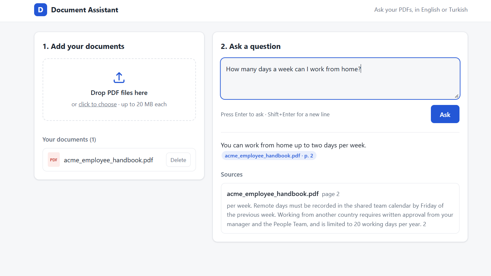
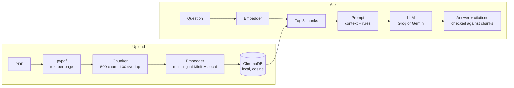

# RAG Document Assistant

[](https://github.com/HasibeeGencc/rag-document-assistant/actions/workflows/ci.yml)

Upload PDFs and ask questions about them in **English or Turkish**. Every answer
cites the document and page it came from, and when the documents don't contain
the answer, the assistant says so instead of making one up.

It runs at zero cost: the embedding model and vector database run locally, and
answers come from the free tier of [Groq](https://console.groq.com) (or Gemini as a backup).

<!-- Screenshot: save it as docs/screenshot.png, then replace this comment with:
 -->
> Screenshot and live demo link: coming soon.

## What it does

- **Upload PDFs** in a simple web UI (drag and drop) or through the REST API.
- **Ask questions** across all uploaded documents. The answer is written in the
  language of the question, even when the document is in the other language.
- **Citations** like `[contract.pdf, p. 2]` appear as clickable chips that show the
  passage the answer is based on. A citation that doesn't match a retrieved passage
  stays plain text and is not listed as a source.
- **"I don't know"**: if the answer isn't in the retrieved passages, the assistant
  replies with a fixed sentence ("I couldn't find the answer in the uploaded
  documents." / "Yüklenen belgelerde bu sorunun cevabını bulamadım.").
- **Manage documents**: list and delete uploaded PDFs.

## Architecture



| Folder | Responsibility |
|---|---|
| `app/ingestion` | PDF → pages → chunks, each with `doc_id`, `filename` and `page` |
| `app/embeddings` | Local sentence-transformers embedder |
| `app/vectorstore` | ChromaDB: add, search, list and delete documents |
| `app/llm` | Provider interface, with Groq and Gemini implementations |
| `app/rag` | Retrieve, build the prompt, answer, extract citations |
| `app/api` | FastAPI routes |
| `app/static` | Web UI (plain HTML, CSS and JavaScript) |
| `tests/` | pytest suite, fully offline |
| `eval/` | Retrieval evaluation with sample documents |

## Tech stack

- **Python 3.11**, **FastAPI**, **Pydantic v2**, pydantic-settings
- **pypdf** for text extraction
- **sentence-transformers** with `paraphrase-multilingual-MiniLM-L12-v2` (runs on CPU)
- **ChromaDB**, persisted to a local folder
- **Groq** (`openai/gpt-oss-20b`) by default, **Google Gemini** (`gemini-2.5-flash`) as an alternative
- **pytest**, **Docker**, **GitHub Actions**

## Run locally

You need Python 3.11 and a free Groq API key from [console.groq.com](https://console.groq.com).

```bash
git clone https://github.com/HasibeeGencc/rag-document-assistant.git
cd rag-document-assistant
python -m venv .venv
```

Activate the virtual environment: `.venv\Scripts\Activate.ps1` on Windows
(PowerShell), or `source .venv/bin/activate` on macOS and Linux. Then:

```bash
pip install torch --index-url https://download.pytorch.org/whl/cpu
pip install -r requirements-dev.txt
cp .env.example .env
```

The first `pip install` gets the CPU-only build of PyTorch, which is much smaller
than the default GPU build. Open `.env` and set `GROQ_API_KEY`. The `.env` file is
git-ignored: never commit it.

```bash
uvicorn app.main:app --reload
```

Open http://localhost:8000 for the web UI, or http://localhost:8000/docs for the
interactive API docs. The first start downloads the embedding model (about 470 MB).

To use Gemini instead, set `LLM_PROVIDER=gemini` and `GEMINI_API_KEY` in `.env`.

### Run the tests

```bash
pytest
```

The tests use a fake LLM and a fake embedder, so they need no API key, no model
download and no internet. CI runs them on every push.

## Run with Docker

```bash
docker build -t rag-document-assistant .
docker run --env-file .env -p 7860:7860 rag-document-assistant
```

Open http://localhost:7860. The embedding model is downloaded while the image is
built, so the container starts without internet access to Hugging Face. API keys are
not baked into the image; they are passed in at runtime with `--env-file`.
Uploaded documents are stored inside the container and are lost when it is removed.

## API

| Method | Path | Description | Success |
|---|---|---|---|
| `GET` | `/health` | Health check | `200 {"status": "ok"}` |
| `POST` | `/documents` | Upload a PDF (multipart field `file`) | `201` with `doc_id`, `page_count`, `chunk_count`, `empty_pages` |
| `GET` | `/documents` | List uploaded documents | `200` list of `doc_id`, `filename`, `chunk_count` |
| `DELETE` | `/documents/{doc_id}` | Delete a document and its chunks | `204` |
| `POST` | `/ask` | Ask a question: `{"question": "...", "doc_ids": [...]}` (`doc_ids` optional) | `200` with `answer` and `sources` |

Errors: `400` empty file, `404` unknown document, `413` file larger than
`MAX_UPLOAD_MB` (default 20), `415` not a PDF, `422` invalid input or a PDF with no
extractable text, `502` the LLM request failed, `503` the LLM is not configured
(missing API key).

Example:

```bash
curl -X POST http://localhost:8000/ask -H "Content-Type: application/json" \
  -d '{"question": "When is payment due?"}'
```

```json
{
  "answer": "Payment is due within 10 days of the invoice date [contract.pdf, p. 2].",
  "sources": [
    {"doc_id": "3f2a…", "filename": "contract.pdf", "page": 2,
     "snippet": "The customer pays the invoice within 10 days…", "score": 0.71}
  ]
}
```

## Evaluation

`eval/` contains three fictional sample PDFs (an English employee handbook, a Turkish
service contract and an English product manual) and 26 questions with the page that
holds each answer. The script measures whether retrieval finds that page:

```bash
python eval/run_eval.py            # retrieval only, no API key needed
python eval/run_eval.py --answers  # also generates 7 example answers with the LLM
```

| Question set | n | Hit@1 | Hit@3 | Hit@5 | MRR |
|---|---|---|---|---|---|
| **All questions** | 26 | 81% | 92% | **96%** | 0.85 |
| Same language as the document | 21 | 90% | 100% | 100% | 0.94 |
| Cross-language (TR question on EN doc, or EN on TR) | 5 | 40% | 60% | 80% | 0.51 |

**Hit@5** is the share of questions where the correct page is among the 5 chunks sent
to the LLM, so it is the number that matters most. **MRR** also rewards ranking the
correct page first (1.0 = always first). All 7 example answers were written in the
language of the question, and the unanswerable question correctly got the "not found"
reply. Full results, per question: [eval/results.md](eval/results.md).

This is a small test set (26 questions, 22 chunks), so treat it as a sanity check,
not a benchmark: one question moves a score by about 4 points.

The evaluation also found a real bug: English questions about the Turkish document
were answered in Turkish. Naming the answer language explicitly in the prompt fixed it.

## Design decisions

- **500-character chunks with 100 characters of overlap.** The embedding model only
  reads the first 128 tokens of a text, so longer chunks would be partly ignored. The
  overlap keeps a sentence that falls on a boundary findable from both sides. Chunks
  never cross page boundaries, so every chunk has exactly one page to cite.
- **Local, multilingual embeddings.** `paraphrase-multilingual-MiniLM-L12-v2` is free,
  runs on a CPU, and maps English and Turkish into the same vector space, so a Turkish
  question can find an English passage. Documents never leave the machine to be embedded.
- **Groq for the LLM.** The free tier is fast and enough for a demo. The LLM sits
  behind a small `LLMProvider` interface, so switching to Gemini is one environment
  variable, and the tests use a fake provider.
- **Citations are checked, not trusted.** The answer's `[file, p. N]` citations are
  matched against the retrieved chunks; only matches are returned as sources.
- **No LLM call when nothing is retrieved.** With no documents, the app answers
  "not found" itself and saves a request.
- **Secrets stay out of code and logs.** Keys are read from `.env` as `SecretStr`, and
  provider errors are reported without the SDK's message, which could contain the key.

## Limitations

- **Scanned PDFs are not supported.** Only PDFs with a text layer work; there is no OCR.
- **Cross-language retrieval is weaker** (Hit@5 80% vs 100% for same-language questions).
  For example, "Hoparlör kaç saat çalışır?" ("How many hours does the speaker run?")
  gets "not found", although the English manual says 8 hours.
- **Language detection is simple.** It only distinguishes English and Turkish, using
  Turkish letters and common Turkish words.
- **No users or authentication.** Everyone using an instance sees the same documents.
- **No conversation memory.** Each question is answered on its own.
- **Groq free-tier rate limits** apply when many questions are asked quickly.

## Roadmap

- Improve cross-language retrieval, for example by translating the question or
  combining vector search with keyword search.
- OCR for scanned PDFs.
- Score answer quality in the evaluation, not only retrieval.
- Per-user document collections.
